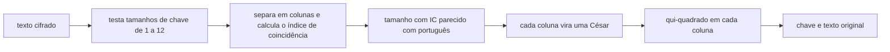

<p align="center"><sub>Cifras Clássicas</sub></p>

---

<p align="center">
  
</p>

<p align="center">
  César, Vigenère e XOR, e a análise de frequência que quebra cada uma em português
</p>

<p align="center">
  
  
  <a href="https://github.com/arthurlynow098/cifras-classicas/actions/workflows/testes.yml"></a>
  
</p>

## Sobre o projeto

Todo curso de segurança começa falando da cifra de César e eu sempre achei aquilo meio bobo, até entender o ponto. Ninguém usa César hoje, mas **o motivo de ela ter caído** é a base de toda a criptografia moderna. Se a cifra deixa o padrão da língua passar, a matemática quebra ela, não importa quão secreta seja a chave.

Esse projeto implementa César, Vigenère e XOR e, mais importante, **quebra** César e Vigenère sem saber a chave, usando análise de frequência do português. É o meu laboratório de criptoanálise, no espírito dos desafios do Cryptopals.

## Como funciona



## Tecnologias

<p>
  
  
</p>

## Executando o código

Só precisa de Python 3.10 ou mais novo. O texto aceita uma frase direta, um caminho de arquivo ou `-` para ler da entrada padrão.

```bash
git clone https://github.com/arthurlynow098/cifras-classicas.git
cd cifras-classicas

python -m cifras cesar "Ave Cesar" 3
python -m cifras vigenere exemplos/texto.txt lince > cifrado.txt

python -m cifras analisar cifrado.txt
python -m cifras quebrar-vigenere cifrado.txt
python -m cifras quebrar-cesar outro.txt --top 5
```

Testes

```bash
pip install -r requirements-dev.txt
python -m pytest -q
```

Os testes cifram o texto de exemplo com uma chave e conferem que o programa recupera a mesma chave sozinho.

## Exemplo

O texto de `exemplos/texto.txt` cifrado com Vigenère e a chave `lince` começa assim

```text
L kektewtteqqn cgzuccrsi n jyxiakhllr je xcvvs emzrs. Za tgrpznkw cwzcrza ...
```

```text
$ python -m cifras analisar cifrado.txt

  índice de coincidência  0.0431
  (português fica perto de 0.072, texto aleatório perto de 0.038)

  tamanhos de chave mais prováveis
    10  0.0809
    5   0.0803
    2   0.0433

$ python -m cifras quebrar-vigenere cifrado.txt

  chave provável  lince

A criptografia acompanha a humanidade ha muito tempo. Os generais romanos ...
```

## Estudei por aqui

Segui essas aulas e materiais para entender e aplicar tudo que está aqui.

| Material | O que tirei dele |
|---|---|
| [TryHackMe, Introduction to Cryptography](https://tryhackme.com/room/cryptographyintro) | Cifras clássicas e a transição para a criptografia moderna |
| [Cryptopals](https://cryptopals.com/) | Desafios práticos de criptoanálise, de onde veio a ideia de pontuar o texto |
| [OverTheWire Bandit](https://overthewire.org/wargames/bandit/) | Prática de terminal, onde aparecem ROT13 e codificações |
| [Curso em Vídeo, Python Mundo 1](https://www.youtube.com/playlist?list=PLHz_AreHm4dlKP6QQCekuIPky1CiwmdI6) | Base de Python que usei em todos os projetos |

## Licença

Distribuído sob a licença MIT. Veja o arquivo [LICENSE](LICENSE).

<p align="center"><sub>A gravura do banner é o escaravelho da prancha de besouros de Georgiy Jacobson, em domínio público no <a href="https://commons.wikimedia.org/wiki/File%3AGeorgiy_Jacobson_-_Beetles_Russia_and_Western_Europe_-_plate_30.jpg">Wikimedia Commons</a>.</sub></p>
