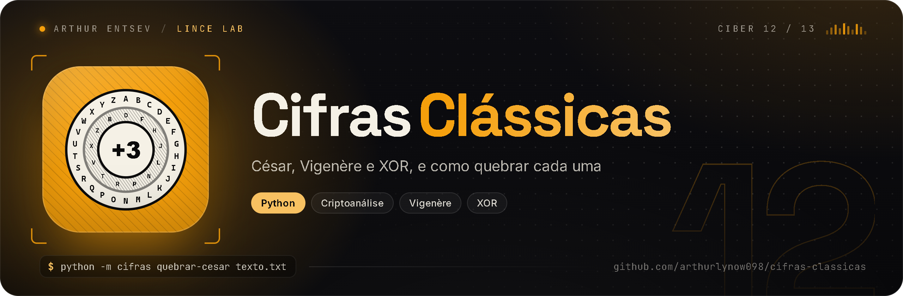
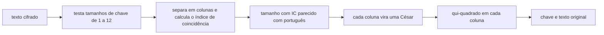

<a id="top"></a>

<p align="center"></p>

<p align="center">


<a href="https://github.com/arthurlynow098/cifras-classicas/actions/workflows/testes.yml"></a>

</p>

<p align="center"><a href="#sobre">Sobre</a> &nbsp;&nbsp; <a href="#como-funciona">Como funciona</a> &nbsp;&nbsp; <a href="#rodando">Rodando</a> &nbsp;&nbsp; <a href="#aprendi">O que aprendi</a> &nbsp;&nbsp; <a href="#estudos">Estudos</a></p>

<a id="sobre"></a>

<p></p>

Todo curso de segurança começa falando da cifra de César e eu sempre achei aquilo meio bobo, até entender o ponto. Ninguém usa César hoje, mas **o motivo de ela ter caído** é a base de toda a criptografia moderna. Se a cifra deixa o padrão da língua passar, a matemática quebra ela, não importa quão secreta seja a chave.

Esse projeto implementa César, Vigenère e XOR e, mais importante, **quebra** César e Vigenère sem saber a chave, usando análise de frequência do português. É o meu laboratório de criptoanálise, no espírito dos desafios do Cryptopals.

<a id="como-funciona"></a>

<p></p>

**Quebrando a César.** Em português, A, E e O aparecem muito mais que as outras letras. A César só desloca o alfabeto, então esse "formato" continua igual, só que deslocado. O programa testa os 26 deslocamentos e mede com o teste **qui-quadrado** qual deles deixa a frequência mais parecida com a do português.

**Quebrando a Vigenère.** Ela foi chamada de indecifrável por uns 300 anos porque cada letra é deslocada por um valor diferente, que vem de uma palavra-chave. A quebra tem duas etapas



1. **Achar o tamanho da chave.** O índice de coincidência mede a chance de duas letras sorteadas do texto serem iguais. Em português fica perto de 0,072, em texto aleatório perto de 0,038. Quando eu separo o texto em colunas do tamanho certo, cada coluna volta a ter o IC do português.
2. **Quebrar cada coluna.** Cada coluna foi cifrada com uma única letra da chave, ou seja, é uma César. Aí entra o qui-quadrado de novo.

Um detalhe que me pegou nos testes. O tamanho 10 apareceu com IC um pouco maior que o 5 para a chave `lince`, porque múltiplos do tamanho certo também funcionam. Resolvi escolhendo o **menor** tamanho com IC próximo do melhor.

<a id="rodando"></a>

<p></p>

Só precisa de Python 3.10 ou mais novo. O texto aceita uma frase direta, um caminho de arquivo ou `-` para ler da entrada padrão.

```bash
git clone https://github.com/arthurlynow098/cifras-classicas.git
cd cifras-classicas

python -m cifras cesar "Ave Cesar" 3
python -m cifras vigenere exemplos/texto.txt lince > cifrado.txt

python -m cifras analisar cifrado.txt
python -m cifras quebrar-vigenere cifrado.txt
python -m cifras quebrar-cesar outro.txt --top 5
```

Testes

```bash
pip install -r requirements-dev.txt
python -m pytest -q
```

Os testes cifram o texto de exemplo com uma chave e conferem que o programa recupera a mesma chave sozinho.

<p></p>

O texto de `exemplos/texto.txt` cifrado com Vigenère e a chave `lince` começa assim

```text
L kektewtteqqn cgzuccrsi n jyxiakhllr je xcvvs emzrs. Za tgrpznkw cwzcrza ...
```

```text
$ python -m cifras analisar cifrado.txt

  índice de coincidência  0.0431
  (português fica perto de 0.072, texto aleatório perto de 0.038)

  tamanhos de chave mais prováveis
    10  0.0809
    5   0.0803
    2   0.0433

$ python -m cifras quebrar-vigenere cifrado.txt

  chave provável  lince

A criptografia acompanha a humanidade ha muito tempo. Os generais romanos ...
```

<a id="aprendi"></a>

<p></p>

- Por que esconder o padrão é mais importante que esconder a chave
- Qui-quadrado e índice de coincidência na prática, com números de verdade
- Que XOR com chave curta repetida tem a mesma fraqueza da Vigenère
- Normalizar texto com `unicodedata` para lidar com acentos do português
- Por que a criptografia moderna (AES) é desenhada para que a saída pareça aleatória

Próximos passos

- [ ] Quebrar XOR com chave repetida, como no desafio 6 do Cryptopals
- [ ] Cifra de substituição completa quebrada com bigramas
- [ ] Uma página web que mostra o histograma de frequências mudando em tempo real

<a id="estudos"></a>

<p></p>

Segui essas aulas e materiais para entender e aplicar tudo que está aqui.

| Material | O que tirei dele |
|---|---|
| [TryHackMe, Introduction to Cryptography](https://tryhackme.com/room/cryptographyintro) | Cifras clássicas e a transição para a criptografia moderna |
| [Cryptopals](https://cryptopals.com/) | Desafios práticos de criptoanálise, de onde veio a ideia de pontuar o texto |
| [OverTheWire Bandit](https://overthewire.org/wargames/bandit/) | Prática de terminal, onde aparecem ROT13 e codificações |
| [Curso em Vídeo, Python Mundo 1](https://www.youtube.com/playlist?list=PLHz_AreHm4dlKP6QQCekuIPky1CiwmdI6) | Base de Python que usei em todos os projetos |

<p align="center"><sub>Parte do <a href="https://github.com/arthurlynow098">Lince Lab</a>, minha coleção de projetos de cibersegurança</sub></p>

<p align="center"><a href="#top">Voltar ao topo</a></p>
